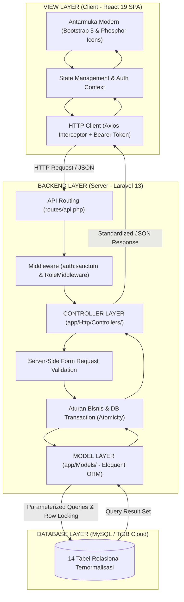
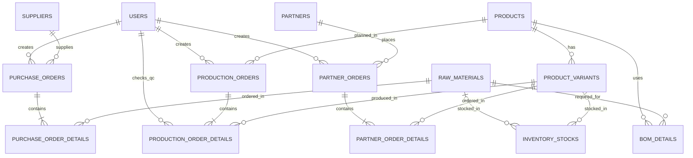

# Nexora SupplyFlow Management System

**Aplikasi Web Pengelolaan Rantai Pasok Terintegrasi Pabrik Sepatu & Sandal (Make to Stock)**  
*Tugas Akhir / Proyek UAS Web Application Development (WAD)*  
**Versi PRD:** 2.6

---

## 🌐 Akses Deployment Online (Production Live)

Aplikasi telah berhasil di-deploy dan dapat diakses langsung secara publik:

| Layanan | Platform | URL / Endpoint | Keterangan |
|---|---|---|---|
| **Frontend Web App** | **Vercel** | 🔗 [nexora-supplyflow-management-system.vercel.app](https://nexora-supplyflow-management-system.vercel.app) | Single Page Application (React 19 + Vite) |
| **Backend REST API** | **Render.com** | 🔗 [nexora-supplyflow-management-system.onrender.com](https://nexora-supplyflow-management-system.onrender.com) | Laravel 13 REST API via Docker Container (PHP 8.4) |
| **Cloud Database** | **TiDB Cloud** | `gateway01.ap-southeast-1.prod.aws.tidbcloud.com:4000` | MySQL 8.0 Protocol di AWS Singapore dengan Enkripsi TLS/SSL |
| **Repository GitHub** | **GitHub** | 🔗 [github.com/sahrul-xyz/nexora-supplyflow-management-system](https://github.com/sahrul-xyz/nexora-supplyflow-management-system) | Source code monorepo (Frontend & Backend) |

> [!NOTE]
> **Catatan Uji Coba Deployment (Cold Start):**  
> Backend di Render menggunakan paket Free Tier yang menerapkan kebijakan *spin down* (hibernasi) jika tidak ada aktivitas selama 15 menit. Jika website baru pertama kali dibuka setelah lama tidak diakses, request login pertama membutuhkan waktu **sekitar 30–50 detik** untuk membangunkan kontainer backend. Setelah terbangun, seluruh operasi sistem berjalan cepat dan responsif.

---

## 1. Tentang Sistem

**Nexora SupplyFlow Management System** adalah aplikasi web modern berbasis Client-Server untuk mengelola seluruh rantai pasok pabrik manufaktur sepatu dan sandal. Sistem mencakup:

1. **Pengadaan Bahan Baku (Procurement):** Pembuatan Purchase Order (PO) langsung oleh Supply Chain kepada vendor supplier terpilih, dan pencatatan penerimaan fisik bahan baku ke gudang.
2. **Perencanaan & Eksekusi Manufaktur (Production):** Perencanaan Production Order Make to Stock (MTS) dengan multi-varian dari satu model produk, perhitungan kebutuhan bahan otomatis berbasis Bill of Materials (BOM), dan pemeriksaan kendali mutu (Quality Control / QC) dengan pemisahan produk lolos dan reject.
3. **Monitoring Inventaris Terpusat (Inventory):** Pemantauan real-time untuk dua gudang: Gudang Bahan Baku (dengan safety stock threshold) dan Gudang Barang Jadi (sepatu/sandal siap kirim).
4. **Distribusi & Penjualan (Distribution):** Pencatatan pesanan mitra reseller dan distributor, eksekusi pengiriman dengan nomor resi ekspedisi (JNE/SiCepat), dan pemotongan stok otomatis saat pengiriman.

---

## 2. Arsitektur & Teknologi

| Komponen | Teknologi | Hosting / Layanan | Keterangan |
|---|---|---|---|
| **Frontend** | React 19, Vite, JavaScript | **Vercel** | SPA responsif dengan client-side routing & rewrite |
| **Desain Antarmuka** | Bootstrap 5, UI/UX Pro Max, Phosphor Icons | - | Konsep **Clean Modern**, tipografi Plus Jakarta Sans |
| **Backend REST API** | Laravel 13, PHP 8.4+ | **Render.com** (Docker) | 52 REST API Endpoints, Sanctum Token Auth, Auto-migration |
| **Database** | MySQL / MariaDB (TiDB Serverless) | **TiDB Cloud** (AWS Singapore) | 14 tabel bisnis, row-level locking, foreign keys, SSL TLS |
| **Keamanan** | Laravel Sanctum, Form Request Validation | - | Proteksi role middleware: Super Admin, Supply Chain, Production |

---

## 3. Arsitektur Model-View-Controller (MVC)

Sistem mengimplementasikan pola **Modern Decoupled MVC (API-Driven MVC)** yang memisahkan tanggung jawab (*Separation of Concerns*) antara logika data di server dengan presentasi antarmuka di klien:



### 3.1 Pemetaan Komponen MVC

1. **Model (M) — `backend/app/Models/`**
   - Mengelola representasi entitas data bisnis, pendefinisian relasi objek (*Eloquent ORM*), *attribute casting*, dan proteksi *mass-assignment* (`$fillable`).
   - Terdapat **14 Model Eloquent**, di antaranya:
     - `Product` & `ProductVariant`: Master artikel sepatu/sandal dan varian SKU per ukuran/warna.
     - `RawMaterial` & `Supplier`: Master bahan baku dan data vendor pemasok.
     - `BomDetail`: Relasi resep bahan baku per model produk.
     - `PurchaseOrder` & `PurchaseOrderDetail`: Entitas pengadaan bahan baku.
     - `ProductionOrder` & `ProductionOrderDetail`: Entitas perencanaan manufaktur Make to Stock dan pencatatan hasil QC.
     - `InventoryStock`: Entitas saldo stok fisik real-time untuk gudang bahan dan gudang jadi.
     - `Partner` & `PartnerOrder`: Entitas reseller/distributor dan pesanan distribusi.
     - `User`: Entitas akun pengguna dan otorisasi peran sistem.

2. **View (V) — `frontend/src/pages/` & `frontend/src/components/`**
   - Bertanggung jawab penuh terhadap penyajian antarmuka pengguna (*User Interface*), menangkap interaksi pengguna (input form, filter data, aksi transaksi), dan me-render data dinamis.
   - Dibangun menggunakan **React 19**, **Bootstrap 5**, dan sistem desain **Clean Modern (UI/UX Pro Max)**.
   - Contoh View:
     - `ProductList.jsx` & `ProductDetail.jsx`: Menampilkan katalog produk, varian SKU, dan komposisi BOM.
     - `ProductionOrderCreate.jsx` & `ProductionOrderDetail.jsx`: Formulir kalkulasi kebutuhan bahan baku dan pencatatan hasil inspeksi mutu (QC).
     - `InventoryOverview.jsx`: Visualisasi kartu stok bahan baku, stok barang jadi, dan safety stock indicator.

3. **Controller (C) — `backend/app/Http/Controllers/`**
   - Bertindak sebagai pengatur alur logika bisnis dan penghubung antara View dan Model.
   - Menerima request dari routing, menjalankan **validasi input server-side yang ketat** (`$request->validate()`), mengeksekusi operasi transaksi atomik (`DB::transaction`), menerapkan *pessimistic row-locking* (`lockForUpdate()`), dan mengembalikan respon terstandarisasi (`success`, `message`, `data`).
   - Contoh Controller:
     - `AuthController.php`: Mengelola autentikasi login via Laravel Sanctum dan token revocation.
     - `ProductController.php` & `ProductVariantController.php`: Operasi CRUD penuh model produk dan varian SKU.
     - `PurchaseOrderController.php`: Pembuatan PO dan penerimaan bahan ke gudang (*Procurement Lifecycle*).
     - `ProductionOrderController.php`: Kalkulasi kebutuhan bahan baku otomatis, validasi kecukupan stok bahan, eksekusi pemotongan bahan, dan pencatatan hasil QC.
     - `PartnerOrderController.php`: Siklus pesanan mitra dan pemotongan stok barang jadi saat pengiriman nomor resi.

### 3.2 Siklus Alur Permintaan (Request Lifecycle MVC)
```text
[Aksi User di Browser] 
    └──► React View mengirim HTTP Request (Axios) membawa Bearer Token
            └──► Laravel Router (routes/api.php) memetakan rute HTTP
                    └──► Middleware memverifikasi token Sanctum & Hak Akses Role
                            └──► Controller memvalidasi input server-side
                                    └──► Controller memanggil Model Eloquent
                                            └──► Model mengeksekusi query aman ke MySQL (Parameterized)
                                                    └──► Controller menyusun Respon JSON
                                                            └──► React View memperbarui State & UI (tanpa reload halaman)
```

---

## 4. Desain Basis Data & Skema ERD

Sistem menerapkan basis data relasional **MySQL (TiDB Cloud)** ternormalisasi (3NF) dengan **14 tabel bisnis relasional** yang terbagi ke dalam 4 pilar rantai pasok:



### 4.1 Empat Klaster Tabel Basis Data

| Klaster | Tabel | Fungsi & Integritas |
|---|---|---|
| **A. Master Data & Pengguna** | `users` | Akun staf dengan 3 peran: `super_admin`, `supply_chain`, `production`. |
| | `products` | Model dasar artikel produk sepatu/sandal (shoes, sandals). |
| | `product_variants` | Varian spesifik (ukuran & warna) dengan **SKU Unik** (BR-01). |
| | `raw_materials` | Master bahan baku dengan batas safety stock minimum (`minimum_stock`). |
| | `suppliers` | Data perusahaan rekanan vendor pemasok bahan. |
| | `partners` | Data toko retail, reseller, dan distributor rekanan pabrik. |
| **B. Pengadaan (Procurement)** | `purchase_orders` | Header pemesanan bahan baku dengan status: `ordered`, `completed`, `cancelled`. |
| | `purchase_order_details` | Rincian bahan, kuantitas dipesan, dan pencatatan fisik kuantitas diterima (BR-04, BR-05). |
| **C. Manufaktur & QC (Production)** | `bom_details` | Resep Bill of Materials (Many-to-Many antara produk dan bahan baku) (BR-02). |
| | `production_orders` | Header perintah kerja Make to Stock (MTS) dengan nomor produksi unik. |
| | `production_order_details` | Rincian target varian, hasil aktual, jumlah lolos QC, dan reject (BR-11, BR-12, BR-13). |
| **D. Inventaris & Penjualan** | `inventory_stocks` | Saldo stok fisik real-time terpadu untuk Gudang Bahan dan Gudang Barang Jadi. |
| | `partner_orders` | Header pesanan penjualan mitra dengan status pengiriman dan nomor resi (BR-15). |
| | `partner_order_details` | Rincian varian produk yang dipesan, harga satuan, dan subtotal penjualan. |

### 4.2 Integritas Relasional & Penanganan Konkurensi
1. **Foreign Key Integrity:** Menerapkan constraint relasional antar-tabel dengan aturan `ON DELETE RESTRICT` pada master data aktif untuk mencegah kehilangan jejak audit transaksi historis.
2. **Kunci Unik (Unique Constraints):** Memastikan tidak terjadi duplikasi SKU (`product_variants.sku`), nomor dokumen (`po_number`, `production_number`, `order_number`), maupun stok per lokasi gudang (`unique_raw_material_stock` dan `unique_variant_stock`).
3. **Pessimistic Locking & Transaksi Atomik:** Setiap mutasi penambahan atau pengurangan saldo stok di tabel `inventory_stocks` diisolasi di dalam blok `DB::transaction()` dan dikunci menggunakan `lockForUpdate()` untuk mencegah kondisi *race condition* dan menjamin nilai stok tidak pernah negatif (BR-17).

---

## 5. Akun Pengguna Bawaan (Default Demo Accounts)

Sistem telah dilengkapi data awal (seed) dengan 3 role pengguna operasional. Semua akun menggunakan kata sandi default: `password123`.

| Role | Email | Kata Sandi | Tanggung Jawab Operasional |
|---|---|---|---|
| **Super Admin** | `admin@supplyflow.com` | `password123` | Akses penuh, manajemen akun staf, konfigurasi sistem |
| **Supply Chain** | `supplychain@supplyflow.com` | `password123` | Supplier, PO bahan, penerimaan barang, mitra, pesanan mitra, pengiriman resi |
| **Production** | `production@supplyflow.com` | `password123` | Master produk & varian (SKU), BOM, Production Order, kalkulasi bahan, pencatatan QC |

*(Pada halaman login telah disediakan tombol cepat **DEMO AKUN (1-KLIK)** untuk login instan tanpa mengetik)*.

---

## 6. Panduan Menjalankan Secara Lokal (Local Development)

### 6.1 Prasyarat Sistem Lokal
- PHP 8.3 atau 8.4+ (dengan ekstensi `pdo_mysql`, `mbstring`, `openssl`, `bcmath`)
- Composer 2.x
- Node.js 18+ dan npm
- MySQL / MariaDB server berjalan pada port 3306

---

### 6.2 Langkah 1: Menjalankan Backend (Laravel 13)

1. Masuk ke direktori `backend`:
   ```bash
   cd backend
   ```

2. Salin environment file dan instal dependensi:
   ```bash
   copy .env.example .env
   composer install
   php artisan key:generate
   ```

3. Sesuaikan konfigurasi database pada `.env`:
   ```env
   DB_CONNECTION=mysql
   DB_HOST=127.0.0.1
   DB_PORT=3306
   DB_DATABASE=supplyflow_scm
   DB_USERNAME=root
   DB_PASSWORD=
   ```

4. Jalankan migrasi dan data seeder:
   ```bash
   php artisan migrate:fresh --seed
   ```

5. Jalankan server backend:
   ```bash
   php artisan serve --port=8000
   ```
   Backend REST API aktif di `http://localhost:8000`.

---

### 6.3 Langkah 2: Menjalankan Frontend (React + Vite)

1. Buka terminal baru dan masuk ke direktori `frontend`:
   ```bash
   cd frontend
   ```

2. Instal dependensi:
   ```bash
   npm install
   ```

3. Pastikan konfigurasi `.env` mengarah ke backend lokal:
   ```env
   VITE_API_BASE_URL=http://localhost:8000/api
   ```

4. Jalankan development server:
   ```bash
   npm run dev
   ```
   Frontend aktif di `http://localhost:5173`. Buka `http://localhost:5173/login` di peramban Anda.

---

## 7. Implementasi Aturan Bisnis (Business Rules)

Sistem menerapkan secara ketat 17 Business Rules dari PRD v2.6:

- **BR-01 (SKU Unik):** Setiap varian sepatu/sandal memiliki SKU unik (contoh: `SNK-001-BLK-40`).
- **BR-02 (Satu BOM per Model):** Satu model produk memiliki satu BOM aktif yang berlaku untuk seluruh ukuran dan warna.
- **BR-03 (PO Langsung & Satu Vendor):** Supply Chain membuat PO langsung tanpa alur Purchase Request (PR), dan satu PO hanya memilih satu supplier.
- **BR-04 & BR-05 (Penerimaan Penuh MVP):** Penerimaan bahan baku dicatat satu kali penuh, dan kuantitas diterima tidak melebihi pesanan.
- **BR-06 (Update Stok Bahan):** Pencatatan penerimaan otomatis menambah stok fisik bahan baku.
- **BR-07 & BR-08 (Kebutuhan Bahan & Multi-Varian):** Kebutuhan bahan = total target produksi seluruh varian × kebutuhan BOM per unit. Satu order produksi memuat varian dari satu model produk.
- **BR-09 & BR-10 (Validasi Stok Bahan Saat Produksi):** Produksi hanya dapat dimulai jika seluruh bahan mencukupi. Saat produksi dimulai, sistem langsung memotong stok bahan baku dari gudang.
- **BR-11 (Konsistensi QC):** Sistem memvalidasi bahwa `Jumlah Aktual = Lolos QC + Reject`.
- **BR-12 & BR-13 (Pemisahan Reject & Lolos QC):** Produk reject hanya dicatat untuk laporan kualitas, sedangkan HANYA produk lolos QC yang masuk ke stok gudang barang jadi.
- **BR-14 (Pesanan Mitra Non-Reservasi):** Pesanan mitra tidak mencadangkan/mereservasi stok.
- **BR-15 & BR-16 (Pengurangan Stok Saat Pengiriman):** Stok barang jadi berkurang saat pengiriman dicatat dengan nomor resi. Sistem menolak pengiriman jika stok barang jadi tidak mencukupi.
- **BR-17 (Integritas Stok & Konkurensi):** Stok tidak boleh bernilai negatif. Seluruh perubahan stok menggunakan `lockForUpdate()` dan database transaction di backend.

---

## 8. Struktur Direktori Proyek

```text
nexora-supplyflow-management-system/
├── backend/
│   ├── app/
│   │   ├── Http/
│   │   │   ├── Controllers/       # Auth, Dashboard, Products, PO, ProdOrder, dll
│   │   │   └── Middleware/        # RoleMiddleware (super_admin, supply_chain, production)
│   │   └── Models/                # 14 Eloquent Models
│   ├── config/                    # database.php (SSL TiDB Cloud), cors.php
│   ├── database/
│   │   ├── migrations/            # 14 tabel relasional bisnis + tabel sistem
│   │   ├── seeders/               # DatabaseSeeder realistis pabrik sepatu/sandal
│   │   └── supplyflow_scm.sql     # File SQL export database
│   ├── Dockerfile                 # Konfigurasi container PHP 8.4 untuk deploy Render
│   ├── routes/
│   │   └── api.php                # 52 REST API routes
│   └── tests/
│       └── Feature/               # SupplyFlowApiTest (100% passed)
│
├── frontend/
│   ├── src/
│   │   ├── components/            # StatCard, StatusBadge, dll
│   │   ├── contexts/              # AuthContext (Sanctum state & role checking)
│   │   ├── layouts/               # MainLayout (Clean Modern Sidebar & Topbar)
│   │   ├── pages/                 # Halaman modular (Auth, Dashboard, Inventory, PO, dll)
│   │   ├── services/api.js        # Axios instance dengan Bearer token interceptor
│   │   ├── App.jsx                # Protected routes & role authorization
│   │   └── index.css              # Clean modern UI/UX styling system
│   └── vercel.json                # Konfigurasi routing rewrite SPA untuk deploy Vercel
│
├── docs/
│   ├── ERD.md                     # ERD diagram Mermaid & kamus data lengkap
│   ├── API-DOCUMENTATION.md       # Dokumentasi 52 REST API endpoints
│   └── ARCHITECTURE.md            # Desain arsitektur, UI tokens, & flow
│
└── README.md
```

---

## 9. Pengujian API Otomatis (Feature Testing)

Backend telah dilengkapi dengan pengujian otomatis:
```bash
cd backend
php artisan test --filter=SupplyFlowApiTest
```

**Hasil Pengujian:**
- `test_login_success_and_returns_token_and_role`: **PASSED**
- `test_dashboard_endpoint_returns_all_four_pillars`: **PASSED**
- `test_purchase_order_flow_and_material_receiving`: **PASSED**
- `test_production_order_validation_and_qc_flow`: **PASSED**

---

## 10. Lisensi & Hak Cipta

Dikembangkan untuk memenuhi Deliverables Ujian Akhir Semester (UAS) mata kuliah Web Application Development (WAD).  
All rights reserved © 2026.
