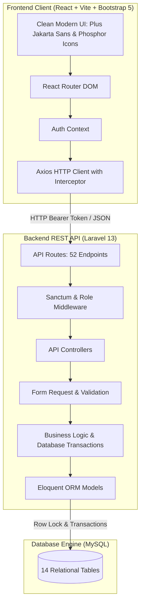
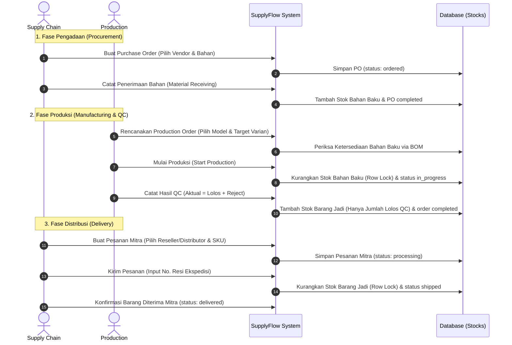

# Dokumen Arsitektur Sistem
## SupplyFlow Management System v2.6

---

## 1. Ikhtisar Arsitektur

SupplyFlow Management System menggunakan arsitektur **Client-Server** terpisah:
- **Frontend Layer:** Single Page Application (SPA) dibangun menggunakan **React 19**, **JavaScript**, **Vite**, dan **Bootstrap 5** dengan prinsip desain **Clean Modern** yang dioptimalkan melalui sistem kecerdasan **UI/UX Pro Max**.
- **Backend Layer:** REST API yang dibangun di atas **Laravel 13** dan **PHP 8.3+**, menggunakan **Laravel Sanctum** untuk autentikasi token berbasis role dan **Eloquent ORM** untuk integritas relasi data.
- **Database Layer:** **MySQL / MariaDB** dengan 14 tabel relasional, constraint integritas referensial, dan transaksi atomic untuk seluruh perubahan stok.



---

## 2. Prinsip Desain Frontend (UI/UX Pro Max - Clean Modern)

Antarmuka dirancang dengan standar kualitas enterprise yang bersih, fungsional, dan nyaman digunakan untuk staf operasional pabrik:

### 2.1 Tipografi
- **Font Family:** `Plus Jakarta Sans` (`weights: 400, 500, 600, 700, 800`)
- **Hierarki:** Judul tegas dengan letter spacing `-0.02em`, angka metrik/KPI bold, label formulir kontras jelas, dan data tabel terstruktur rapi.

### 2.2 Palet Warna & Semantic Tokens
- **Primary Brand:** `#2563EB` (Royal Blue - melambangkan ketepatan rantai pasok dan keandalan sistem)
- **Secondary / Accent:** `#0EA5E9` (Sky Blue) & `#EA580C` (Warm Orange CTA)
- **Neutral Background:** `#F8FAFC` (Slate 50 - latar belakang lembut tanpa silau)
- **Card Surface:** `#FFFFFF` dengan garis tepi halus `1px solid #E2E8F0` dan bayangan lembut `0 1px 3px rgba(0,0,0,0.05)`
- **Status Badges:**
  - `ordered`, `planned`, `processing`: Biru muda lembut (`#DBEAFE`, teks `#1E40AF`)
  - `in_progress`, `shipped`: Kuning amber (`#FEF3C7`, teks `#92400E`)
  - `completed`, `delivered`: Hijau zamrud (`#D1FAE5`, teks `#065F46`)
  - `cancelled`, `danger`, `rejected`: Merah rose (`#FEE2E2`, teks `#991B1B`)
  - `low_stock`: Oranye peringatan (`#FFEDD5`, teks `#9A3412`)

### 2.3 Ikonografi
- **Standar Ikon:** **Phosphor Icons** (`@phosphor-icons/react`) dengan mode duotone dan regular.
- **Disiplin Ikon:** Menghindari penggunaan emoji sebagai elemen navigasi atau status fungsional; menggunakan glyph vektor konsisten dengan touch target optimal.

---

## 3. Alur Model Bisnis Make to Stock (MTS)

Model produksi pabrik sepatu dan sandal beroperasi berdasarkan target stok gudang:



---

## 4. Keamanan & Kontrol Konkurensi Database

### 4.1 Row-Level Locking (`lockForUpdate()`)
Untuk mencegah terjadinya **Race Condition** dan stok negatif (BR-17) ketika beberapa transaksi operasional terjadi bersamaan:
```php
$stock = InventoryStock::where('product_variant_id', $variantId)
    ->where('warehouse_type', 'finished_goods')
    ->lockForUpdate()
    ->first();

if ($stock->quantity < $requestedQty) {
    throw new InsufficientStockException();
}

$stock->quantity -= $requestedQty;
$stock->save();
```

### 4.2 Database Transaction
Semua mutasi transaksi yang melibatkan lebih dari satu tabel (misal: PO detail + update stok; Production order + pemotongan bahan baku; Partner order + pemotongan barang jadi) dibungkus secara utuh dalam `DB::transaction(...)`. Apabila terjadi kegagalan validasi atau error sistem, seluruh perubahan dibatalkan secara atomic (rollback).

### 4.3 Matriks Hak Akses (Role-Based Access Control)
| Fitur / Modul | Super Admin | Supply Chain | Production |
|---|:---:|:---:|:---:|
| Dashboard Rantai Pasok | Full | Full | Full |
| Monitoring Stok Gudang | Full | Full | Full |
| Kelola Akun Staf (Users) | Full | - | - |
| Master Data Produk & Varian | Full | Read-Only | Full |
| Master Data Bahan Baku | Full | Full | Read-Only |
| Master Data Supplier | Full | Full | Read-Only |
| Bill of Materials (BOM) | Full | Read-Only | Full |
| Purchase Order & Penerimaan | Full | Full | - |
| Production Order & QC | Full | - | Full |
| Master Mitra & Pesanan Mitra | Full | Full | - |
| Pengiriman & Pelacakan Resi | Full | Full | - |
