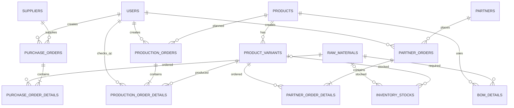

# Entity Relationship Diagram (ERD) & Kamus Data
## SupplyFlow Management System v2.6

Aplikasi terintegrasi rantai pasok pabrik sepatu dan sandal dengan model manufaktur **Make to Stock (MTS)**.

---

## 1. Diagram ERD (Mermaid)

---

## 2. Kamus Data (Data Dictionary)

Database: `supplyflow_scm` (MySQL / MariaDB)

### 2.1 Tabel `users`
Menyimpan akun pengguna dan role akses operasional sistem.
| Kolom | Tipe | Nullable | Default | Keterangan |
|---|---|---|---|---|
| `id` | BIGINT UNSIGNED | No | Auto Increment | Primary Key |
| `name` | VARCHAR(100) | No | - | Nama lengkap pengguna |
| `email` | VARCHAR(150) | No | - | Email unik (login) |
| `email_verified_at` | TIMESTAMP | Yes | NULL | Verifikasi email |
| `password` | VARCHAR(255) | No | - | Hashed password bcrypt |
| `role` | ENUM | No | 'supply_chain' | `super_admin`, `supply_chain`, `production` |
| `remember_token` | VARCHAR(100) | Yes | NULL | Token sesi remember me |
| `created_at` | TIMESTAMP | Yes | NULL | Waktu pembuatan |
| `updated_at` | TIMESTAMP | Yes | NULL | Waktu pembaruan |

### 2.2 Tabel `products`
Menyimpan model dasar produk sepatu atau sandal.
| Kolom | Tipe | Nullable | Default | Keterangan |
|---|---|---|---|---|
| `id` | BIGINT UNSIGNED | No | Auto Increment | Primary Key |
| `product_code` | VARCHAR(30) | No | - | Kode produk unik |
| `product_name` | VARCHAR(150) | No | - | Nama model produk |
| `category` | ENUM | No | - | `shoes`, `sandals` |
| `description` | TEXT | Yes | NULL | Deskripsi spesifikasi |
| `is_active` | BOOLEAN | No | true | Status aktif (soft deactivate) |
| `created_at` | TIMESTAMP | Yes | NULL | Waktu pembuatan |
| `updated_at` | TIMESTAMP | Yes | NULL | Waktu pembaruan |

### 2.3 Tabel `product_variants`
Menyimpan varian spesifik (ukuran, warna, SKU) dari model produk.
| Kolom | Tipe | Nullable | Default | Keterangan |
|---|---|---|---|---|
| `id` | BIGINT UNSIGNED | No | Auto Increment | Primary Key |
| `product_id` | BIGINT UNSIGNED | No | - | FK → `products.id` |
| `sku` | VARCHAR(50) | No | - | Stock Keeping Unit unik (BR-01) |
| `size` | VARCHAR(10) | No | - | Ukuran sepatu/sandal (e.g. 40, 41, 42) |
| `color` | VARCHAR(50) | No | - | Warna (Black, White, Olive, dll) |
| `is_active` | BOOLEAN | No | true | Status aktif |
| `created_at` | TIMESTAMP | Yes | NULL | Waktu pembuatan |
| `updated_at` | TIMESTAMP | Yes | NULL | Waktu pembaruan |

### 2.4 Tabel `raw_materials`
Menyimpan master data bahan baku pabrik sepatu/sandal.
| Kolom | Tipe | Nullable | Default | Keterangan |
|---|---|---|---|---|
| `id` | BIGINT UNSIGNED | No | Auto Increment | Primary Key |
| `material_code` | VARCHAR(30) | No | - | Kode bahan unik |
| `material_name` | VARCHAR(150) | No | - | Nama bahan (kulit sintetis, sol, lem) |
| `unit` | VARCHAR(20) | No | - | Satuan (meter, pasang, ml, lembar) |
| `minimum_stock` | DECIMAL(12,2) | No | 0.00 | Safety stock minimum |
| `is_active` | BOOLEAN | No | true | Status aktif |
| `created_at` | TIMESTAMP | Yes | NULL | Waktu pembuatan |
| `updated_at` | TIMESTAMP | Yes | NULL | Waktu pembaruan |

### 2.5 Tabel `suppliers`
Menyimpan data pemasok bahan baku.
| Kolom | Tipe | Nullable | Default | Keterangan |
|---|---|---|---|---|
| `id` | BIGINT UNSIGNED | No | Auto Increment | Primary Key |
| `supplier_name` | VARCHAR(150) | No | - | Nama perusahaan vendor |
| `contact_person` | VARCHAR(100) | Yes | NULL | Nama PIC |
| `phone` | VARCHAR(20) | Yes | NULL | Nomor kontak |
| `email` | VARCHAR(150) | Yes | NULL | Alamat email |
| `address` | TEXT | Yes | NULL | Alamat kantor/gudang |
| `created_at` | TIMESTAMP | Yes | NULL | Waktu pembuatan |
| `updated_at` | TIMESTAMP | Yes | NULL | Waktu pembaruan |

### 2.6 Tabel `bom_details`
Menyimpan Bill of Materials: kebutuhan bahan baku per 1 unit model produk (BR-02).
| Kolom | Tipe | Nullable | Default | Keterangan |
|---|---|---|---|---|
| `id` | BIGINT UNSIGNED | No | Auto Increment | Primary Key |
| `product_id` | BIGINT UNSIGNED | No | - | FK → `products.id` |
| `raw_material_id` | BIGINT UNSIGNED | No | - | FK → `raw_materials.id` |
| `quantity_required` | DECIMAL(12,3) | No | - | Kebutuhan bahan per pasang sepatu/sandal |
| `created_at` | TIMESTAMP | Yes | NULL | Waktu pembuatan |
| `updated_at` | TIMESTAMP | Yes | NULL | Waktu pembaruan |
*Unique composite index:* `(product_id, raw_material_id)`

### 2.7 Tabel `purchase_orders`
Header pesanan pembelian bahan baku oleh Supply Chain.
| Kolom | Tipe | Nullable | Default | Keterangan |
|---|---|---|---|---|
| `id` | BIGINT UNSIGNED | No | Auto Increment | Primary Key |
| `po_number` | VARCHAR(30) | No | - | Nomor PO unik (`PO-YYYYMM-XXX`) |
| `supplier_id` | BIGINT UNSIGNED | No | - | FK → `suppliers.id` (BR-03) |
| `created_by` | BIGINT UNSIGNED | No | - | FK → `users.id` |
| `order_date` | DATE | No | - | Tanggal PO dibuat |
| `status` | ENUM | No | 'ordered' | `ordered`, `completed`, `cancelled` |
| `notes` | TEXT | Yes | NULL | Catatan pembelian |
| `created_at` | TIMESTAMP | Yes | NULL | Waktu pembuatan |
| `updated_at` | TIMESTAMP | Yes | NULL | Waktu pembaruan |

### 2.8 Tabel `purchase_order_details`
Item bahan baku yang dibeli dan diterima pada Purchase Order.
| Kolom | Tipe | Nullable | Default | Keterangan |
|---|---|---|---|---|
| `id` | BIGINT UNSIGNED | No | Auto Increment | Primary Key |
| `purchase_order_id` | BIGINT UNSIGNED | No | - | FK → `purchase_orders.id` |
| `raw_material_id` | BIGINT UNSIGNED | No | - | FK → `raw_materials.id` |
| `quantity_ordered` | DECIMAL(12,2) | No | - | Jumlah dipesan |
| `quantity_received` | DECIMAL(12,2) | No | 0.00 | Jumlah diterima fisik (BR-04, BR-05) |
| `unit_price` | DECIMAL(12,2) | No | - | Harga beli per satuan |
| `created_at` | TIMESTAMP | Yes | NULL | Waktu pembuatan |
| `updated_at` | TIMESTAMP | Yes | NULL | Waktu pembaruan |

### 2.9 Tabel `production_orders`
Header perencanaan dan perintah kerja manufaktur Make to Stock.
| Kolom | Tipe | Nullable | Default | Keterangan |
|---|---|---|---|---|
| `id` | BIGINT UNSIGNED | No | Auto Increment | Primary Key |
| `production_number` | VARCHAR(30) | No | - | Nomor produksi unik (`PROD-YYYYMM-XXX`) |
| `created_by` | BIGINT UNSIGNED | No | - | FK → `users.id` |
| `product_id` | BIGINT UNSIGNED | No | - | FK → `products.id` (BR-08) |
| `production_date` | DATE | No | - | Tanggal rencana produksi |
| `status` | ENUM | No | 'planned' | `planned`, `in_progress`, `completed`, `cancelled` |
| `notes` | TEXT | Yes | NULL | Catatan batch produksi |
| `created_at` | TIMESTAMP | Yes | NULL | Waktu pembuatan |
| `updated_at` | TIMESTAMP | Yes | NULL | Waktu pembaruan |

### 2.10 Tabel `production_order_details`
Rincian target varian dan hasil inspeksi QC.
| Kolom | Tipe | Nullable | Default | Keterangan |
|---|---|---|---|---|
| `id` | BIGINT UNSIGNED | No | Auto Increment | Primary Key |
| `production_order_id` | BIGINT UNSIGNED | No | - | FK → `production_orders.id` |
| `product_variant_id` | BIGINT UNSIGNED | No | - | FK → `product_variants.id` |
| `target_quantity` | INT UNSIGNED | No | - | Target produksi pasang |
| `actual_quantity` | INT UNSIGNED | No | 0 | Total hasil aktual (BR-11) |
| `passed_quantity` | INT UNSIGNED | No | 0 | Jumlah lolos QC (masuk stok barang jadi - BR-13) |
| `rejected_quantity` | INT UNSIGNED | No | 0 | Jumlah reject (hanya laporan - BR-12) |
| `qc_checked_by` | BIGINT UNSIGNED | Yes | NULL | FK → `users.id` |
| `qc_checked_at` | DATETIME | Yes | NULL | Waktu inspeksi QC dicatat |
| `created_at` | TIMESTAMP | Yes | NULL | Waktu pembuatan |
| `updated_at` | TIMESTAMP | Yes | NULL | Waktu pembaruan |

### 2.11 Tabel `inventory_stocks`
Stok fisik terpusat untuk kedua gudang: Bahan Baku & Barang Jadi (BR-17).
| Kolom | Tipe | Nullable | Default | Keterangan |
|---|---|---|---|---|
| `id` | BIGINT UNSIGNED | No | Auto Increment | Primary Key |
| `raw_material_id` | BIGINT UNSIGNED | Yes | NULL | FK → `raw_materials.id` (gudang bahan) |
| `product_variant_id` | BIGINT UNSIGNED | Yes | NULL | FK → `product_variants.id` (gudang jadi) |
| `warehouse_type` | ENUM | No | - | `raw_material`, `finished_goods` |
| `quantity` | DECIMAL(12,2) | No | 0.00 | Jumlah stok fisik real-time |
| `created_at` | TIMESTAMP | Yes | NULL | Waktu pembuatan |
| `updated_at` | TIMESTAMP | Yes | NULL | Waktu pembaruan |
*Unique indexes:*
- `unique_raw_material_stock`: `(warehouse_type, raw_material_id)`
- `unique_variant_stock`: `(warehouse_type, product_variant_id)`

### 2.12 Tabel `partners`
Master data reseller toko retail dan distributor besar.
| Kolom | Tipe | Nullable | Default | Keterangan |
|---|---|---|---|---|
| `id` | BIGINT UNSIGNED | No | Auto Increment | Primary Key |
| `partner_code` | VARCHAR(30) | No | - | Kode unik mitra |
| `partner_name` | VARCHAR(150) | No | - | Nama toko / badan usaha |
| `partner_type` | ENUM | No | - | `reseller`, `distributor` |
| `contact_person` | VARCHAR(100) | Yes | NULL | Nama PIC |
| `phone` | VARCHAR(20) | Yes | NULL | Nomor telepon/WhatsApp |
| `email` | VARCHAR(150) | Yes | NULL | Email mitra |
| `address` | TEXT | Yes | NULL | Alamat pengiriman utama |
| `is_active` | BOOLEAN | No | true | Status kemitraan |
| `created_at` | TIMESTAMP | Yes | NULL | Waktu pembuatan |
| `updated_at` | TIMESTAMP | Yes | NULL | Waktu pembaruan |

### 2.13 Tabel `partner_orders`
Header pesanan distribusi ke reseller atau distributor.
| Kolom | Tipe | Nullable | Default | Keterangan |
|---|---|---|---|---|
| `id` | BIGINT UNSIGNED | No | Auto Increment | Primary Key |
| `order_number` | VARCHAR(30) | No | - | Nomor pesanan unik (`ORD-YYYYMM-XXX`) |
| `partner_id` | BIGINT UNSIGNED | No | - | FK → `partners.id` |
| `created_by` | BIGINT UNSIGNED | No | - | FK → `users.id` |
| `order_date` | DATE | No | - | Tanggal pesanan dibuat |
| `status` | ENUM | No | 'processing' | `processing`, `shipped`, `delivered`, `cancelled` |
| `shipping_address` | TEXT | No | - | Alamat tujuan kirim |
| `tracking_number` | VARCHAR(100) | Yes | NULL | Nomor resi ekspedisi (JNE/SiCepat) |
| `shipped_at` | DATETIME | Yes | NULL | Waktu barang dikirim fisik |
| `delivered_at` | DATETIME | Yes | NULL | Waktu barang diterima mitra |
| `notes` | TEXT | Yes | NULL | Catatan pesanan |
| `created_at` | TIMESTAMP | Yes | NULL | Waktu pembuatan |
| `updated_at` | TIMESTAMP | Yes | NULL | Waktu pembaruan |

### 2.14 Tabel `partner_order_details`
Item varian sepatu/sandal yang dipesan mitra.
| Kolom | Tipe | Nullable | Default | Keterangan |
|---|---|---|---|---|
| `id` | BIGINT UNSIGNED | No | Auto Increment | Primary Key |
| `partner_order_id` | BIGINT UNSIGNED | No | - | FK → `partner_orders.id` |
| `product_variant_id` | BIGINT UNSIGNED | No | - | FK → `product_variants.id` |
| `quantity` | INT UNSIGNED | No | - | Kuantitas pasang sepatu |
| `unit_price` | DECIMAL(12,2) | No | - | Harga jual satuan |
| `subtotal` | DECIMAL(14,2) | No | - | `quantity * unit_price` |
| `created_at` | TIMESTAMP | Yes | NULL | Waktu pembuatan |
| `updated_at` | TIMESTAMP | Yes | NULL | Waktu pembaruan |
